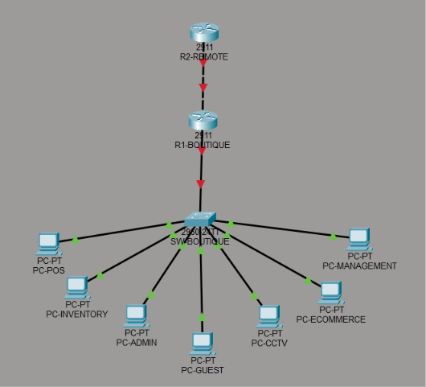

# IPv6 Dual Stack Rollout - Aanchal Boutique

Dual stack (IPv4 + IPv6) network for a fictional women's clothing boutique, built in Cisco Packet Tracer.

**Status:** Task 1 (IPv6 plan), Task 2 (dual stack on routers) and Task 3 (SLAAC and DHCPv6) complete.

## Topology



```
R2-REMOTE (2911)  Lo0 = remote site LAN
     | G0/0  10.0.12.2/30  2001:db8:aa:100::2/64
     |
     | G0/0  10.0.12.1/30  2001:db8:aa:100::1/64
R1-BOUTIQUE (2911)   router-on-a-stick, subinterfaces G0/1.X
     | G0/1  802.1Q trunk (VLANs 10,20,30,40,50,60,99)
     | Gi0/1
SW-BOUTIQUE (2960, layer 2)
     |-- Fa0/1 PC-POS        VLAN 10
     |-- Fa0/2 PC-INVENTORY  VLAN 20
     |-- Fa0/3 PC-ADMIN      VLAN 30
     |-- Fa0/4 PC-GUEST      VLAN 40
     |-- Fa0/5 PC-CCTV       VLAN 50
     |-- Fa0/6 PC-ECOMMERCE  VLAN 60
     `-- Fa0/7 PC-MANAGEMENT VLAN 99
```

## Addressing and VLAN plan

IPv6 block: `2001:0db8:00aa::/48` (compressed `2001:db8:aa::/48`, documentation prefix).
Rule: **one /64 per VLAN and per link, subnet ID = VLAN ID**, so IPv4 third octet and IPv6 subnet ID always match.

| VLAN | Name | Purpose | IPv4 | IPv6 full | IPv6 compressed | Gateway (v4 / v6) |
|---|---|---|---|---|---|---|
| 10 | POS | Billing counter | 192.168.10.0/24 | 2001:0db8:00aa:0010:0000:0000:0000:0000/64 | 2001:db8:aa:10::/64 | .1 / ::1 |
| 20 | INVENTORY | Stock system | 192.168.20.0/24 | 2001:0db8:00aa:0020:0000:0000:0000:0000/64 | 2001:db8:aa:20::/64 | .1 / ::1 |
| 30 | ADMIN | Owner and staff office | 192.168.30.0/24 | 2001:0db8:00aa:0030:0000:0000:0000:0000/64 | 2001:db8:aa:30::/64 | .1 / ::1 |
| 40 | GUEST | Customer Wi-Fi | 192.168.40.0/24 | 2001:0db8:00aa:0040:0000:0000:0000:0000/64 | 2001:db8:aa:40::/64 | .1 / ::1 |
| 50 | CCTV | Cameras | 192.168.50.0/24 | 2001:0db8:00aa:0050:0000:0000:0000:0000/64 | 2001:db8:aa:50::/64 | .1 / ::1 |
| 60 | ECOMMERCE | Online store | 192.168.60.0/24 | 2001:0db8:00aa:0060:0000:0000:0000:0000/64 | 2001:db8:aa:60::/64 | .1 / ::1 |
| 99 | MANAGEMENT | Network devices | 192.168.99.0/24 | 2001:0db8:00aa:0099:0000:0000:0000:0000/64 | 2001:db8:aa:99::/64 | .1 / ::1 |
| - | WAN link R1-R2 | Site to site | 10.0.12.0/30 | 2001:0db8:00aa:0100:0000:0000:0000:0000/64 | 2001:db8:aa:100::/64 | R1 .1 / ::1, R2 .2 / ::2 |
| - | Remote LAN (R2 Lo0) | Remote site | 192.168.200.0/24 | 2001:0db8:00aa:0200:0000:0000:0000:0000/64 | 2001:db8:aa:200::/64 | R2 .1 / ::1 |

Host addresses used for testing: `.10` and `::10` in each VLAN. Link-local gateway on every R1 subinterface: `FE80::1`.

### Device interfaces

| Device | Interface | IPv4 | IPv6 |
|---|---|---|---|
| R1-BOUTIQUE | G0/0 | 10.0.12.1/30 | FE80::1, 2001:DB8:AA:100::1/64 |
| R1-BOUTIQUE | G0/1.10 to G0/1.99 | 192.168.X.1/24 | FE80::1, 2001:DB8:AA:X::1/64 |
| R2-REMOTE | G0/0 | 10.0.12.2/30 | FE80::2, 2001:DB8:AA:100::2/64 |
| R2-REMOTE | Loopback0 | 192.168.200.1/24 | FE80::2, 2001:DB8:AA:200::1/64 |
| SW-BOUTIQUE | Vlan99 | 192.168.99.2/24 | layer 2 switch, see notes |

## Design decision and trade-off

**Decision:** one /64 per VLAN and per link, with the VLAN ID reused as the IPv6 subnet ID, and the same link-local address `FE80::1` on every router subinterface.

**Why:** an engineer can read the VLAN from any IPv6 address (`2001:db8:aa:30::10` is VLAN 30) and the IPv4 and IPv6 plans stay in step. A fixed link-local gateway means hosts keep the same default gateway even if the global prefix is renumbered later.

**Trade-off:** a /64 per VLAN wastes address space compared with IPv4, but a /64 is required for SLAAC (Task 3), and a /48 holds 65,536 /64s, so the waste is not a problem. Link ranges start at `:100` so they never collide with VLAN IDs. The same `FE80::1` on several subinterfaces is allowed because link-local scope is per interface, but it means the interface must always be named when pinging a link-local address.

## Tests

| Test | Command | Expected | Result | Evidence |
|---|---|---|---|---|
| Host to gateway IPv4 | `ping 192.168.10.1` (PC-POS) | 0% loss | PASS | outputs/pc-pos-to-gateway.txt |
| Host to gateway IPv6 | `ping 2001:DB8:AA:10::1` (PC-POS) | 0% loss | PASS | outputs/pc-pos-to-gateway.txt |
| Inter-VLAN IPv4 | `ping 192.168.30.10` (PC-POS) | 0% loss, TTL 127 | PASS | outputs/pc-pos-to-pc-admin.txt |
| Inter-VLAN IPv6 | `ping 2001:DB8:AA:30::10` (PC-POS) | 0% loss, TTL 127 | PASS | outputs/pc-pos-to-pc-admin.txt |
| WAN IPv4 | `ping 10.0.12.2` (R1) | success | PASS | outputs/r1-to-r2.txt |
| WAN IPv6 | `ping 2001:DB8:AA:100::2` (R1) | success | PASS | outputs/r1-to-r2.txt |
| Trace to R2 | `traceroute 2001:DB8:AA:100::2` (R1) | one hop | PASS | outputs/r1-to-r2.txt |
| Interface state | `show ipv6 interface brief` (R1, R2) | all subinterfaces up with one global prefix | PASS | outputs/R1-ipv6-int-br.txt, outputs/R2-ipv6-int-br.txt |
| Trunk | `show interfaces trunk` (SW) | 10,20,30,40,50,60,99 allowed | PASS | outputs/SW-trunk.txt |

The TTL of 127 on inter-VLAN pings shows the packet crossed R1 (host default is 128).

## Failure test: WAN link down

Link R1 G0/0 to R2 was shut down on R1 and brought back up. The whole test (before, shutdown, after, recovered) is in one file: **outputs/failure-test.txt**. The single files `failure-test-after-down.txt` and `failure-test-recovered.txt` are kept as the raw captures.

| Stage | Action | Result | Evidence |
|---|---|---|---|
| Before | `ping 2001:DB8:AA:100::2` from R1 | success | outputs/failure-test.txt (stage 1) |
| After (down) | `interface g0/0` then `shutdown`, ping IPv6 and IPv4 | fails, G0/0 administratively down | outputs/failure-test.txt (stage 3) |
| Recovered | `no shutdown`, ping IPv6 and IPv4 | success again | outputs/failure-test.txt (stage 4) |

Key lines from the saved outputs:

```
BEFORE (R1, link up):
R1-BOUTIQUE#ping 2001:DB8:AA:100::2
!!!!!
Success rate is 100 percent (5/5), round-trip min/avg/max = 0/0/0 ms

DOWN (R1, after "interface g0/0" + "shutdown"):
R1-BOUTIQUE#ping 2001:DB8:AA:100::2
.....
Success rate is 0 percent (0/5)
R1-BOUTIQUE#ping 10.0.12.2
.....
Success rate is 0 percent (0/5)
GigabitEthernet0/0         [administratively down/down]
    FE80::1
    2001:DB8:AA:100::1

RECOVERED (R1, after "no shutdown"):
R1-BOUTIQUE#ping 2001:DB8:AA:100::2
!!!!!
Success rate is 100 percent (5/5), round-trip min/avg/max = 0/0/0 ms
R1-BOUTIQUE#ping 10.0.12.2
!!!!!
Success rate is 100 percent (5/5), round-trip min/avg/max = 0/0/0 ms
GigabitEthernet0/0         [up/up]
    FE80::1
    2001:DB8:AA:100::1
```

Other VLAN subinterfaces stayed up/up during the failure, so only the WAN to the remote site was affected.

## Task 2: Dual stack on routers and the switch

Every interface that carries traffic has both an IPv4 and an IPv6 address: R1 G0/0 (WAN) and the seven VLAN subinterfaces G0/1.10 to G0/1.99, R2 G0/0 and Loopback0, and the switch management interface Vlan99 (IPv4). The device interface table above lists every address. `ipv6 unicast-routing` is enabled on both routers.

| What | Command | Evidence |
|---|---|---|
| R1 dual stack state | `show ip interface brief`, `show ipv6 interface brief` | outputs/R1-ip-int-br.txt, outputs/R1-ipv6-int-br.txt |
| R2 dual stack state | `show ip interface brief`, `show ipv6 interface brief` | outputs/R2-ip-int-br.txt, outputs/R2-ipv6-int-br.txt |
| Switch VLANs and trunk | `show vlan brief`, `show interfaces trunk` | outputs/SW-vlan-brief.txt, outputs/SW-trunk.txt |
| Running configs | `show running-config` | configs/R1-BOUTIQUE.txt, configs/R2-REMOTE.txt, configs/SW-BOUTIQUE.txt |
| Reachability over both protocols | ping IPv4 and IPv6, gateway, inter-VLAN and WAN | outputs/pc-pos-to-gateway.txt, outputs/pc-pos-to-pc-admin.txt, outputs/r1-to-r2.txt |
| Link failure | WAN shutdown and recovery | outputs/failure-test.txt |

### Task 2 design decision and trade-off

**Decision:** keep inter-VLAN routing on the router (router on a stick): one 802.1Q trunk from SW-BOUTIQUE to R1 G0/1, one dual stack subinterface per VLAN.

**Why:** the switch in this lab is a layer 2 Cisco 2960, not a multilayer switch, so it cannot route between VLANs or carry IPv6 gateway addresses. A router subinterface per VLAN gives the same result with one config to read, and each VLAN has the same `.1` and `::1` gateway in IPv4 and IPv6.

**Trade-off:** all VLAN traffic goes up and down one physical link and through one router, so that link is a bottleneck and a single point of failure. For a small boutique this is acceptable. With a multilayer switch, SVIs with `ip routing` and `ipv6 unicast-routing` would route inside the switch at wire speed and keep traffic local, at the cost of more expensive hardware and a switch that needs a dual stack SDM template.

## Task 3: SLAAC for staff, DHCPv6 for servers

### Addressing method per VLAN

| VLAN | Name | IPv6 method | Why |
|---|---|---|---|
| 10 | POS | SLAAC | Staff tills, zero configuration |
| 30 | ADMIN | SLAAC | Staff office |
| 40 | GUEST | SLAAC | Customer devices come and go |
| 20 | INVENTORY | Stateful DHCPv6 (pool SRV-INVENTORY) | Server, central pool and binding log |
| 60 | ECOMMERCE | Stateful DHCPv6 (pool SRV-ECOMMERCE) | Server, central pool and binding log |
| 50 | CCTV | Static (unchanged) | Cameras need a fixed address |
| 99 | MANAGEMENT | Static (unchanged) | Management stays predictable |

Servers are represented by hosts in VLAN 20 (inventory) and VLAN 60 (e-commerce). The router R1 is the DHCPv6 server.

### Configuration on R1

```
ipv6 dhcp pool SRV-INVENTORY
 address prefix 2001:DB8:AA:20::/64
 dns-server 2001:4860:4860::8888
 domain-name aanchal.local
ipv6 dhcp pool SRV-ECOMMERCE
 address prefix 2001:DB8:AA:60::/64
 dns-server 2001:4860:4860::8888
 domain-name aanchal.local
interface GigabitEthernet0/1.20
 ipv6 nd managed-config-flag
 ipv6 dhcp server SRV-INVENTORY
interface GigabitEthernet0/1.60
 ipv6 nd managed-config-flag
 ipv6 dhcp server SRV-ECOMMERCE
```

SLAAC VLANs need no extra configuration: with `ipv6 unicast-routing` each subinterface already sends router advertisements. `managed-config-flag` tells VLAN 20 and 60 clients to use DHCPv6.

### Client addresses (saved as text in outputs/)

| Client | VLAN | Method | IPv6 address received | DNS | File |
|---|---|---|---|---|---|
| PC-POS | 10 | SLAAC | 2001:DB8:AA:10:20D:BDFF:FEA5:25AD | none | client-addresses-POS.txt |
| PC-ADMIN | 30 | SLAAC | 2001:DB8:AA:30:201:C7FF:FE57:DE20 | none | client-addresses-Admin.txt |
| PC-GUEST | 40 | SLAAC | 2001:DB8:AA:40:20A:41FF:FECA:D50C | none | client-addresses-Guest.txt |
| PC-INVENTORY | 20 | DHCPv6 | 2001:DB8:AA:20:A1C0:4070:FC14:D18E | 2001:4860:4860::8888 | client-addresses-INVENTORY.txt |
| PC-ECOMMERCE | 60 | DHCPv6 | 2001:DB8:AA:60:9F84:675C:A052:57D | 2001:4860:4860::8888 | client-addresses-ECOMMERCE.txt |

SLAAC clients build the interface ID from their MAC address (EUI-64), for example MAC 000D.BDA5.25AD gives ...:20D:BDFF:FEA5:25AD. All five clients use gateway FE80::1, learned from the router advertisement. The DHCPv6 leases are listed in outputs/R1-dhcpv6.txt.

### Task 3 tests

| Test | Command | Expected | Result | Evidence |
|---|---|---|---|---|
| SLAAC address | `ipconfig /all` on PC-POS, PC-ADMIN, PC-GUEST | VLAN prefix + EUI-64, gateway FE80::1 | PASS | client-addresses-*.txt |
| DHCPv6 address | `ipconfig /all` on PC-INVENTORY, PC-ECOMMERCE | address from pool, DNS set | PASS | client-addresses-*.txt |
| Lease records | `show ipv6 dhcp binding`, `show ipv6 dhcp pool` (R1) | one binding per server | PASS | R1-dhcpv6.txt |
| Gateway | `ping 2001:DB8:AA:10::1` (PC-POS) | 0% loss | PASS | task3-pings.txt |
| SLAAC client to DHCPv6 server | `ping 2001:DB8:AA:20:A1C0:4070:FC14:D18E` (PC-POS) | 0% loss, TTL 127 | PASS | task3-pings.txt |

### Failure test: DHCPv6 server removed from VLAN 20

The whole test (before, server removed, after, recovered) is in one file: **outputs/failure3-test.txt**. The single captures `failure3-before.txt`, `failure3-down.txt` and `failure3-recovered.txt` are kept as the raw outputs.

| Stage | Action | Result | Evidence |
|---|---|---|---|
| Before | PC-INVENTORY holds a lease | IPv6 2001:DB8:AA:20:A1C0:4070:FC14:D18E, DNS 2001:4860:4860::8888, gateway FE80::1 | failure3-test.txt (stage 1) |
| Down | `no ipv6 dhcp server SRV-INVENTORY` on G0/1.20, `clear ipv6 dhcp binding`, client renews | IPv6 address `::`, DNS `::`, only link-local FE80 left | failure3-test.txt (stage 3) |
| Recovered | `ipv6 dhcp server SRV-INVENTORY` re-applied, client renews | address and DNS back, gateway FE80::1 back after the router advertisement | failure3-test.txt (stage 4) |

Observation: right after the lease came back the gateway still showed `::`, because DHCPv6 does not hand out a default gateway. The gateway returns with the next router advertisement (a few minutes). IPv4 on the client was unaffected during the whole test.

### Task 3 design decision and trade-off

**Decision:** SLAAC for staff and guest VLANs, stateful DHCPv6 for the two server VLANs.

**Why:** staff and guest devices change often, and SLAAC needs no server or per-device setup. Servers get addresses and DNS from a central pool with a binding log, so it is clear which server holds which address.

**Trade-off:** SLAAC alone gives no DNS server (the SLAAC clients show DNS `::`), so staff would need RDNSS in the router advertisement or stateless DHCPv6 added later. SLAAC EUI-64 addresses also expose the device MAC address. DHCPv6 adds pools and flags to manage, and a server's address can change at renewal, so a real production server should get a reservation or a static address.

### Packet Tracer limitations

- `ipv6 nd prefix ... no-autoconfig` is rejected by this Packet Tracer version (`Invalid input`). On real IOS it would be added on G0/1.20 and G0/1.60 so servers use only DHCPv6 and do not also self-assign a SLAAC address. In this lab the failure test showed no address at all while the server was removed.
- `show ipv6 dhcp pool` counts "8 in use" for SRV-INVENTORY while one client is active. This is a Packet Tracer counter and does not match real leases (see `show ipv6 dhcp binding`).

## Configuration notes and known limits

- `ipv6 unicast-routing` is enabled on R1 and R2. Without it a router will not forward IPv6.
- During build, the subinterfaces briefly carried a second, stale prefix (`2001:DB8:ACBA:X::1`). It was removed so each VLAN has exactly one global prefix, and the final `show ipv6 interface brief` confirms this.
- SW-BOUTIQUE is a layer 2 switch (2960). Routing between VLANs is done on R1 (router on a stick), so the switch has no layer 3 IPv6 role. The switch is managed over IPv4 only, on Vlan99 (192.168.99.2/24).
- Task 2 used static host addresses. Task 3 replaced them with SLAAC and DHCPv6 on VLANs 10, 20, 30, 40, 60 (see the Task 3 section above). VLANs 50 and 99 stay static.
- Packet Tracer shows `no ipv6 cef` on the routers. This is the Packet Tracer default and does not affect forwarding here.

## Repository layout

```
README.md
Topology.png
configs/   R1-BOUTIQUE.txt  R2-REMOTE.txt  SW-BOUTIQUE.txt
outputs/   ping, traceroute, show ip/ipv6 interface brief, vlan, trunk, failure test
```

## Note on what I did and why

I planned a /48 carved into one /64 per VLAN and per link, matched to the existing IPv4 plan, then configured dual stack on R1 (router on a stick over an 802.1Q trunk) and R2. I checked the result with host to gateway, inter-VLAN and site to site pings, and proved the link failure and recovery. I then added SLAAC for the staff and guest VLANs and stateful DHCPv6 for the server VLANs, saved every client address as text, and tested a DHCPv6 failure with before, after and recovered output. The plan is built so later changes can be added without renumbering.
